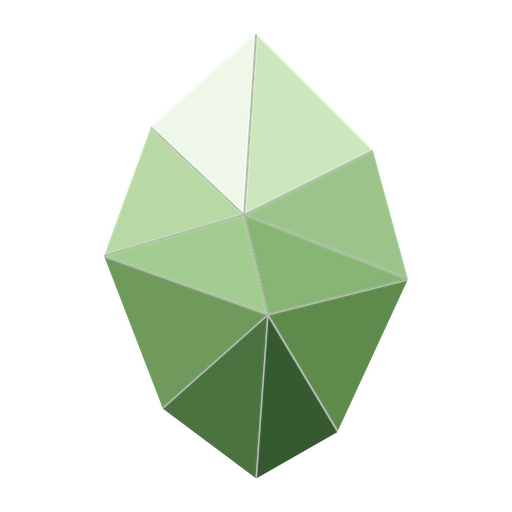

  

<h1 align="center">Carbonian</h1>

<b>The terminal is the desktop.</b>

Carbonian is a Debian-based distribution built around the command line. Its desktop is
**carbonian-shell**, a Wayland compositor made of tmux: panes are windows, tmux sessions are the
panels, and a graphical program docks into the pane that started it. One palette colours
everything from the first boot frame to the last, and every moment in between is designed: the
boot, the login, the session, the logout.

- **On a PC:** a layer over Debian 13 (trixie, amd64): add the archive, install
  `carbonian-desktop`.
- **On a Raspberry Pi 2:** the same experience over a base rebuilt for its Cortex-A7
  (ARMv7, NEON-VFPv4).
- **Oliva** is the default palette: carbonado green, a green diamond on black.

Carbonian is in development. The source and the first release will be published here.

[carbonian.org](https://carbonian.org)
